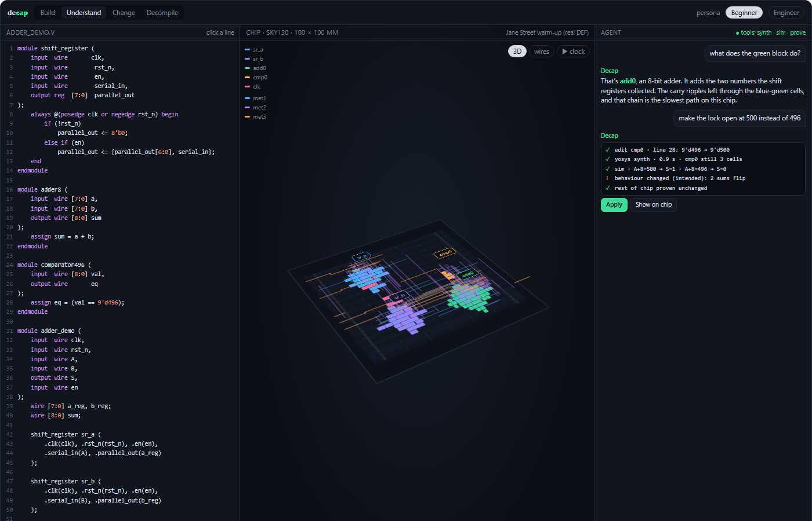

# Decap IDE

**Draft, not council-scored.** A buildable shape of Yuyao's Decap (#4), aimed at a tool judges can click. GlassDie (`08-glassdie.md`) is still the scored G-Research bet (90.7). This doc does not replace that call.

**Screen:** [09-decap-ide-mockup.html](09-decap-ide-mockup.html). Code on the left, the chip in the centre, the agent on the right. The chip is Jane Street's published warm-up: 230 placed cells and 609 routed wire segments from `warmup/03_post_place_and_route.def` in `janestreet/asic-puzzle-2026`.

> Type Verilog on the left. See the blocks of a real chip in the middle. Ask the agent to change one block, and only accept the change once synthesis and a check agree.

## The four decisions

| Decision | Choice | Why |
|---|---|---|
| What a "section" is | A Verilog module instance (a block), not a gate | Measured below: after mapping, per-gate source lines disappear |
| How you change one | Edit that module's source, re-synthesise, check, then Apply | The agent proposes. Yosys and the simulator decide |
| Where it runs | A local web page, with Python running Yosys beside it | Yosys-as-a-local-process already ran here in 1.2 s. A JetBrains plugin did not |
| Which prize | MetaView, and JetBrains only as "a tool a developer would use" | Instalily is out. G-Research stays with GlassDie unless the team switches on purpose |

## What you see



```
┌ Decap ─ Build · Understand · Change · Decompile ──────── persona: Beginner ▾ ┐
│ CODE (left)            │ CHIP (centre)                    │ AGENT (right)     │
│ adder_demo.v           │  real 100 × 100 µm die           │ what does the     │
│  module adder8         │  sr_a   sr_b                     │ green block do?   │
│  ▶ assign sum = a + b; │  ████   ████                     │                   │
│  module comparator496  │       add0                       │ add0 is an 8-bit  │
│    assign eq = val==…  │       ████  cmp0 ██              │ adder. Its carry  │
│                        │  met1 / met2 / met3 wires        │ chain is the      │
│ click a line →         │  click a block → card + source   │ slowest path.     │
│ that block lights up   │                                  │ [Apply] after the │
│                        │  clk ▁▔▁▔   A 11110000   S ▁▁▔   │ check passes      │
├────────────────────────┴──────────────────────────────────┴───────────────────┤
│ 76 logic cells · slowest path: add0 carry · sim matches the vectors · 0 lint  │
└────────────────────────────────────────────────────────────────────────────────┘
```

| Column | Job |
|---|---|
| Code | The source that created the chip. Clicking a line lights the block that module became. |
| Chip | The placed-and-routed die. Blocks are coloured and labelled. Wires sit on the real metal layers. A card explains the selected block and lets you poke it. |
| Agent | Reads the selected block, proposes a source edit, and shows the tool log: synth, sim, proof. Apply is enabled only after that log is green. |

Four modes sit in the top bar. **Understand** and **Change** are the weekend. **Build** (describe a chip in English and watch it appear) and **Decompile** (names stripped, structure recovered, Yosys proves the recovered Verilog) are the same screen with different inputs. They are cut first if the day slips.

The persona pill only changes the wording on the card and in the agent: Beginner gets the conveyor-belt sentence, Engineer gets the cell types. It is a demo toggle. We are not building Instalily's evaluator, personas-as-a-product, or their hidden-test harness.

## Understanding a section

These chips are small (76 logic cells on the warm-up, once filler is ignored) and still unreadable as rectangles. The fix is to collapse the die into a handful of blocks a person can hold in their head, and to make each block do something when you click it.

The warm-up, from its layout file and from a hierarchy-preserving Yosys run on the same source:

| Block | Cells in the real layout | Cells in our Yosys run | What it does |
|---|---|---|---|
| `sr_a` | 16 | 16 | Shift register. Pin A enters one bit per clock. After 8 clocks it holds an 8-bit number. |
| `sr_b` | 16 | 16 | The same, fed from pin B. Same clock, so the two numbers arrive together. |
| `add0` | 41 | 25 | Adds those two numbers. The carry walks from the low bit to the high bit. |
| `cmp0` | 3 | 3 | The lock. Output S is 1 only when the sum equals 496. The constant is folded into the wiring of three gates. |
| clock tree | 3 | (inserted later, by clock-tree synthesis) | Fans the clock out so the flip-flops tick together. |
| filler | 151 | none | Taps, decap, filler. Power and gaps. Hidden while you are reading the logic. |

The 41-versus-25 adder counts are two different synthesis flows, not a measured optimisation. A live edit has to re-synthesise and re-place. We will not quote that gap as a win.

Five things on screen, and none of them need the model:

1. **Colour and a label.** Each block is a district. `cmp0` is three gates and still gets a name, because three gates with a label are readable and three gates without one are not.
2. **One card.** Name, one sentence, cell count, share of the logic area, and the three most common cell types. Beginner and Engineer are two sentences over the same facts.
3. **Only the wires that touch it.** Selecting `add0` dims everything else. You see `a_reg` and `b_reg` come in and the sum leave for `cmp0`.
4. **A link to the module, not to a gate.** Clicking `assign sum = a + b` lights `add0`. Clicking a gate inside `add0` scrolls to that module.
5. **Try it, on the card.** The adder adds the two numbers you type. The lock reports S for a sum you type. The shift register shifts a bit you click. This is the block's function running in the card, so "what does this do?" is answered before anyone opens the agent.

### Why the link stops at the module

We ran Yosys (YoWASP) on `warmup/00_source.v` against the SKY130 liberty file.

- Cold process start: 15.3 s. Warm run: **1.2 s**.
- Flattened synthesis: **54 cells, 16 still carrying a `src` attribute.** All 16 are the flip-flops, and all of them point at the same `always` block. The 38 logic gates lost their source location in `abc`.
- Hierarchy kept: modules survive as `shift_register` (16), `adder8` (25), `comparator496` (3). Area was 807 versus 700 flattened, about 15% for keeping the boundaries.
- The real DEF already names every gate with its instance prefix (`add0/_34_`, `sr_a/_08_`, `cmp0/_4_`) and names the nets (`a_reg[0]`, `S`).

So "click any gate, jump to the exact source column" is not an honest feature after mapping. "Click any gate, jump to the module that owns it" is, on this chip and on any flow that keeps hierarchy or instance prefixes. Inside a block, the optional zoom is **bit lanes**: group the adder's gates by which sum bit they feed, using those surviving net names, so bit 0 sits at one end of the district and the carry walks toward bit 8. That is the readable interior of a small block. It is scheduled after the card works, and it is cut if it slips.

## Changing a section

You change a block by changing its Verilog. You never hand-edit a gate.

1. Select the block. The agent is handed that module's source, its cell count, and its neighbours' port names. It is not handed the whole die.
2. It proposes a new body for that module and shows the diff in the code column.
3. Tools run, and the log is the thing on screen:
   - **synth** — Yosys, hierarchy kept, timed. Per-module cell counts come back.
   - **sim** — the gate-level simulator on a fixed set of vectors. The log says which outputs flipped.
   - **prove** — only for a change that was supposed to keep the behaviour. Yosys equivalence on that module.
   - **unchanged** — the other modules' netlists are hashed. If `sr_a` was not in the edit, its hash must match.
4. **Apply** writes the source and updates the chip. Until Apply, the die is the previous build.

Two kinds of edit, two different greens:

| You asked for | Example on this chip | Pass looks like |
|---|---|---|
| A new behaviour | "Open the lock at 500 instead of 496" | Sim: S rises at 500 and stays low at 496. The other three modules hash-identical. The code line is marked. `cmp0` stays about 3 cells, so the picture barely moves, and the UI says so. |
| The same behaviour, a different circuit | "Make the adder smaller" | Equivalence proof on `adder8`. Cell count and the estimated carry depth shown as the cost. Only `add0`'s rectangle is re-placed. `sr_a`, `sr_b` and `cmp0` keep their coordinates, so the change is a local patch. |

The agent is not allowed to say "proven" or "equivalent" unless the proof tool returned yes. A behaviour change is reported as a behaviour change, with the vectors that flipped.

Placement rule, so a change stays readable: unchanged blocks keep the coordinates from the DEF. The edited block is re-packed inside its own rectangle, bit 0 at the low end. If the new cells do not fit, that rectangle grows and neighbours slide. They do not get a fresh place-and-route of the whole chip, which would reshuffle everything and destroy the diff.

## Browser, desktop app, or JetBrains

| Form | What it is | Weekend cost | Fit |
|---|---|---|---|
| **Local web app** | The mockup, served by a small Python process that shells out to YoWASP | The UI shell exists. The process already synthesised this chip | Judges open a localhost tab. Tools stay on disk, including the 12 MB liberty file |
| In-browser Yosys only | Same UI, Yosys compiled to WASM inside the page, no Python | Not run yet. YoWASP-in-Python is proven; YoWASP-in-the-page is a port | Better booth story if it lands. Fallback is the row above |
| Desktop shell (Tauri / Electron) | The same page in a window | Packaging on top of a working page | Feels like an app. Adds install pain for a judge's laptop. Skip |
| JetBrains plugin | A tool window inside IntelliJ / PyCharm / their Air environment | A second product: plugin SDK, editor wiring, a place to put the die | Their brief prefers "inside their IDEs". A real plugin beside the chip view does not fit in a day |

**Build the local web app.** It is an IDE in the shape that matters: editor, the thing the code became, and an agent with tools. It is the adaptation of "an app like JetBrains" that we can finish. A plugin is a Sunday extra, and only as a thin panel that opens this same page next to their editor. If that panel slips, the demo is unchanged.

Instalily is out. Their prize wants an evaluator harness, hidden tests, and a product their engineers drive against personas. That is a different product from a chip IDE, and it would eat the day the chip view needs.

Prize map, said plainly:

- **MetaView** is the clean fit. The demo is a real chip you can read and edit.
- **JetBrains** is a partial fit. We can say "a tool we would use while writing Verilog" and, if someone has an hour, show their IDE beside it. We should not expect the prize for a plugin we did not ship.
- **G-Research** is GlassDie's prize. Decap IDE has no held-out number. Decompile mode is the only piece with their shape, and it is on the cut list.
- **Instalily** is not entered.

## How it fits together

```
adder_demo.v  (Monaco, or the mockup's line view for the demo)
        │
        ▼
Python sidecar
   yowasp-yosys  synth -top adder_demo     (no -flatten)
   yowasp-yosys  equiv on one module, when the edit claims same behaviour
        │
        ├─ per-module cell list + src where it survived
        ▼
Block placer
   unchanged modules: coordinates copied from the DEF
   edited module: row-packed in its own rectangle, bits in order
        │
        ▼
Chip view
   cells + metal from the DEF (this chip) or from the placer (after an edit)
   click ↔ module span in the editor
        │
        ▼
Simulator
   SKY130 liberty `function` / `ff` for the cell types this chip uses
   fixed vectors, waveform on screen
        │
        ▼
Agent
   tools: read_block, edit_module, synth, sim, prove, unchanged
   the model writes a proposal; the log is what the user trusts
```

Prep scripts stay in Python. The page is static HTML for the weekend, the same file as the mockup, with the sidecar added behind the buttons. A later version can be Next.js and Django. Standing those up on Saturday does not make the chip more true.

### Already measured, on this machine, 7 Nov 2026

| Fact | Result |
|---|---|
| Warm-up files | `00_source.v`, `01_netlist.v`, `03_post_place_and_route.def` fetched from the public repo |
| Die | `DIEAREA ( 0 0 ) ( 100000 100000 )`, 230 components, 8 pins, 84 nets |
| Block names in the DEF | Present: `add0/`, `sr_a/`, `sr_b/`, `cmp0/` |
| Routed metal | Parsed to 609 segments across met1–met3 |
| Liberty | `sky130_fd_sc_hd__tt_025C_1v80.lib`, 12.8 MB, from OpenROAD flow scripts. The SkyWater GitHub copy is a JSON stub, not the liberty file |
| Yosys | YoWASP import works. Warm synth 1.2 s. Hierarchy kept. `src` survives on flops only |

### Not measured yet

- Yosys equivalence on `adder8` or `comparator496`. The command is standard. It has not been run on this design.
- A browser build of Yosys.
- iverilog on Windows. The demo vectors can be checked by the JS simulator against a handful of hand-computed cases (200+296=496 → S=1, 200+300=500 → S=0). "Matches iverilog" is a label we earn only if iverilog actually runs.

## Is this a realistic build?

**Yes, for one real chip, read as four blocks, with one checked edit.** That demo can be honest, because the geometry is already on disk and the synthesis time is already 1.2 seconds.

**No, for a general chip IDE.** Arbitrary Verilog, a real OpenROAD layout, per-gate source maps, a JetBrains plugin, and an agent that vibecodes a new chip are each a project. Together they are not a weekend.

### Demo (90 seconds)

1. Open the warm-up. "This file is a chip that was placed and routed. 230 cells."
2. Click `add0`. The adder lights, the card says what it does, the `assign sum` line lights, you type 200 + 40 and see 240.
3. Click the lock. "Three gates. S is 1 only at 496." Run the clock. The waveform shows S rising when the sum gets there.
4. Tell the agent to open the lock at 500. The log shows the edit, the synth time, and the two vectors that flip. Apply. The source line changes. S moves.
5. Stop. "The rest of the chip was hashed and did not change."

### 24-hour plan

| When | Done means | Cut if it slips |
|---|---|---|
| Hour 0–2 | The mockup, on the real DEF, click block ↔ module, card text for the four blocks | — |
| Hour 2–6 | Simulator steps the warm-up. S is 1 at sum 496 and 0 at 500, on fixed vectors | Drop the waveform animation. Keep the vector list |
| Hour 4–8 | Sidecar: edit `9'd496` to `9'd500`, Yosys returns, `cmp0` still a handful of cells, other module hashes match | Precompute this one run and play the log live. Say so if asked |
| Hour 6–12 | Agent buttons call those tools. Two prompts work: explain `add0`, change the lock | A scripted transcript with real tool output pasted in. Still show the command and the result |
| Hour 10–16 | "Make the adder smaller": equiv check, and `add0` re-packed in its rectangle while the other blocks stay | Ship the proof and the cell-count delta. Leave the old geometry on screen and label it |
| After that | Bit lanes inside the adder. Decompile mode on the warm-up with names stripped. A JetBrains panel that iframes the page | All three drop, in that order |
| Last 3 hours | One backup recording. Rehearse the 90 seconds three times | — |

**Never cut:** the real die, block labels, one card that is true, one edit whose vectors actually flip.

**Gates**

- **Hour 2.** Clicking each of the four blocks lights the right module. If the DEF prefix parse is wrong, stop and fix it before any agent work.
- **Hour 6.** The vector `sum == 496` passes and `sum == 500` fails on the unedited chip. If the simulator is still wrong, the agent does not get a Change button.
- **Hour 12.** The 496 → 500 edit runs through Yosys and the vectors swap. If Yosys is down, use the precomputed netlist and remove the word "live".

### Who does what

| Person | Owns |
|---|---|
| A | Chip view, selection, card, code links. Starts from the mockup |
| B | Liberty functions for the cell types on this die, the simulator, the vectors |
| C | Yosys sidecar, the edit/prove/hash tools, the agent log |

The model key is the OpenAI key JetBrains is giving out at the booth. It stays in the sidecar's environment, not in the page and not in git. Explain-this-block can fall back to the card's own sentence if the key fails. Change cannot: Change without Yosys is a fake button, and the hour-12 gate removes it.

## What we are refusing to pretend

- That every gate maps back to a source line. It does not, after `abc`. The module is the link.
- That a 3-cell constant change redraws the die. It does not. The source and the waveform move.
- That 25 cells versus 41 is a result. It is two flows.
- That the agent checked a change it only described.
- That this is Instalily, or a JetBrains plugin, or a replacement for GlassDie's scored result.

## Open questions for Yuyao

1. Does the team switch off GlassDie for the weekend, or is this a second prototype beside it? One person can push the mockup to the hour-6 gate without that decision. The placer and the agent need the team.
2. Is MetaView the prize we are dressing for? That says: spend the day on the die and the one true edit, and skip the plugin.
3. Decompile mode is the Jane Street story (strip the names, recover the four blocks, prove the Verilog). It is the first cut. Say if it should be the ending of the demo instead.
